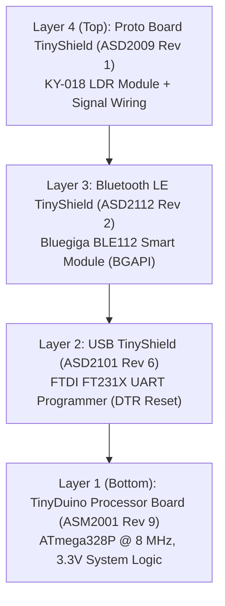

# ☀️ TinyDuino LightMeter (`shadow-claw-light-meter`)

> Hardware light meter workbench, Web Bluetooth / BGAPI telemetry engine, declarative WebMCP sensory tools, and autonomous agent skills for **TinyDuino (ASM2001)** + **Bluegiga BLE112 (ASD2112)** + **KY-018 Photoresistor** on **Analog Pin A0**, published with [ShadowClaw](https://github.com/xt-ml/shadow-claw).

## 🚀 Quick Start (Just Get Going)

```bash
npm start
```

_Builds the LightMeter site, launches the local server on `http://127.0.0.1:8888`, and opens your browser directly to the interactive workbench._

---

- **Interactive Workbench**: [`/main/tinyduino`](https://xt-ml.github.io/shadow-claw-light-meter/main/tinyduino) (direct top-level execution with Web Bluetooth)
- **Portal Index**: [`/main`](https://xt-ml.github.io/shadow-claw-light-meter/main)
- **Live Wokwi Simulation**: [https://wokwi.com/projects/479603659463545857](https://wokwi.com/projects/479603659463545857)
- **Agent Skills Discovery**: `/.well-known/agent-skills/index.json`

---

## 🔬 Hardware Architecture



The hardware stack is composed of miniature 20mm × 20mm TinyShields following the [TinyDuino Setup Tutorial](https://learn.tinycircuits.com/Processors/TinyDuino_Setup_Tutorial/) and [TinyShield Compatibility Matrix](https://tinycircuits.com/pages/tinyduino-overview#tinyshield-compatibility):

1. **[TinyDuino Processor Board (`ASM2001 Rev 9`)](https://tinycircuits.com/collections/processors/products/tinyduino-processor-board?variant=14479557959)**: ATmega328P @ 8 MHz, 3.3V logic, 32 KB Flash, 2 KB SRAM.
2. **[Bluetooth Low Energy TinyShield (`ASD2112 Rev 2`)](https://learn.tinycircuits.com/Obsolete/BLE-bluegiga_TinyShield_Tutorial/)**: Bluegiga BLE112 Bluetooth Smart module running `BGLib_U1A1P_38400_noflow` firmware over `SoftwareSerial(3, 4)` at 38,400 baud.
3. **[USB TinyShield (`ASD2101 Rev 6`)](https://tinycircuits.com/products/usb-tinyshield?variant=14982646535)**: FTDI FT231X USB-to-UART bridge with DTR auto-reset for sketch flashing at 115,200 baud.
4. **[Proto Board TinyShield (`ASD2009 Rev 1`)](https://tinycircuits.com/products/proto-board-tinyshield?variant=14984618887)**: Houses the 3-pin KY-018 photoresistor module wired to `VCC` (3.3V), `GND`, and `Pin A0`.

---

## 🌟 Interactive Workbench Features

Accessible at [`pages/main/tinyduino.html`](pages/main/tinyduino.html) (`/main/tinyduino`):

- **☀️ Real-Time LightMeter Visualizer**: Large percentage gauge (0–100%), lighting condition classification (`direct_sun`, `daylight`, `indoor`, `dark_indoor`, `night`), signal voltage (3.3V ref), estimated illuminance in lux, and dynamic session min/max tracking.
- **📈 60-Sample Waveform Canvas**: Rolling analog brightness chart rendered directly to HTML5 canvas.
- **⚡ Web Bluetooth GATT Transport**: Direct connection to Bluegiga Data Transceiver Service (`195ae58a-...` Handle 17 write, Handle 20 notify) with a mandatory 300ms CCCD settling delay for BlueZ Linux compatibility.
- **🎮 Hardware Controls**: Toggle Onboard LED (Pin 13) and Proto LED (Pin 7) between `ON`, `OFF`, and `AUTO` (BLE connection heartbeat).
- **⏱️ Non-Blocking Telemetry Streaming**: Start/stop live streaming with adjustable intervals: 250ms (4 Hz), 500ms (2 Hz), 1000ms (1 Hz).
- **🔍 GATT & BGAPI Packet Inspector**: Real-time filterable log displaying TX/RX packets, hex byte representations, and status acknowledgments.
- **🧪 Offline Hardware Simulation**: Fully functional virtual simulator for testing when disconnected from physical hardware.

---

## 📚 Documentation & Hardware Guides

| Chapter                       | Pretty Path                                                    | Description                                                                            |
| :---------------------------- | :------------------------------------------------------------- | :------------------------------------------------------------------------------------- |
| **01. Hardware Architecture** | [`/main/hardware-architecture/`](/main/hardware-architecture/) | 4-layer stack diagram, pinouts, and power distribution                                 |
| **02. Wiring Schematic**      | [`/main/wiring-schematic/`](/main/wiring-schematic/)           | KY-018 photoresistor wiring, 10k pull-down divider, and 3.3V rail safety               |
| **03. BLE112 BGAPI Protocol** | [`/main/ble112-bgapi/`](/main/ble112-bgapi/)                   | GATT UUIDs, Handle 17/20, BGAPI framing, and BlueZ 300ms CCCD settling delay           |
| **04. KY-018 Calibration**    | [`/main/ky018-calibration/`](/main/ky018-calibration/)         | Photoconductive power-law curve, ADC-to-lux math, and polarity modes                   |
| **05. Field Diagnostics**     | [`/main/field-diagnostics/`](/main/field-diagnostics/)         | Field report: hardware verification, boot packet decoding, and break handling          |
| **06. Divider Math & MathML** | [`/main/divider-math/`](/main/divider-math/)                   | Voltage divider proof with native MathML resolving light/dark inversion                |
| **07. Wokwi Simulation**      | [`/main/wokwi-simulation/`](/main/wokwi-simulation/)           | In-browser breadboard simulation with custom C-chip BLE112 emulation                   |
| **08. Firmware Guide**        | [`/main/firmware-guide/`](/main/firmware-guide/)               | `shadow-claw-light-meter.ino` 4x oversampled ADC, BGLib submodule, and `bin/upload.sh` |
| **09. WebMCP Sensory Tools**  | [`/main/webmcp-tools/`](/main/webmcp-tools/)                   | 13 declarative WebMCP tools with schemas, annotations, and DevTools usage              |
| **10. Agent Skills**          | [`/main/agent-skills/`](/main/agent-skills/)                   | Autonomous agent skills (/lightmeter, /nightlight, /tinyduino-doctor, etc.)            |
| **11. Workbench UI**          | [`/main/workbench-ui/`](/main/workbench-ui/)                   | Interactive `<tinyduino-control-panel>`, real-time SVG gauge, and waveform chart       |
| **12. Namespace Isolation**   | [`/main/namespace-isolation/`](/main/namespace-isolation/)     | Strict namespace isolation and collision prevention contract                           |
| **13. Troubleshooting**       | [`/main/troubleshooting/`](/main/troubleshooting/)             | Diagnosing BlueZ GATT Error 133, Web Serial breaks, and DevTools WebMCP                |
| **14. Download Center**       | [`/main/download-center/`](/main/download-center/)             | Direct downloads for sketches, Wokwi diagram, BLE112 C chip, and scripts               |

---

## 🤖 13 Declarative WebMCP Sensory Tools

Defined in [`bin/tool-manifest.mjs`](bin/tool-manifest.mjs) and generated into [`.agents/tools/*.json`](.agents/tools/):

| Tool Name                         | Annotations | Description                                                                                                 |
| :-------------------------------- | :---------: | :---------------------------------------------------------------------------------------------------------- |
| `tinyduino_read_light`            |  Read-Only  | Triggers 4x-oversampled A0 analog read over GATT Handle 17 and returns live lux, voltage, and brightness %. |
| `tinyduino_get_status`            |  Read-Only  | Retrieves current connection state, recent samples, and telemetry without transmitting a packet.            |
| `tinyduino_set_led`               |  Mutating   | Controls LED mode: `ON`, `OFF`, or `AUTO` (connection blink).                                               |
| `tinyduino_stream_light`          |  Mutating   | Starts continuous telemetry streaming at 250ms, 500ms, or 1000ms intervals.                                 |
| `tinyduino_stop_stream`           |  Mutating   | Halts continuous telemetry streaming.                                                                       |
| `tinyduino_send_command`          |  Mutating   | Sends arbitrary ASCII text command string to GATT Handle 17.                                                |
| `tinyduino_send_raw`              |  Mutating   | Sends raw hexadecimal bytes to GATT Handle 17.                                                              |
| `tinyduino_connect`               |  Mutating   | Launches Web Bluetooth chooser or starts offline hardware simulation.                                       |
| `tinyduino_disconnect`            |  Mutating   | Closes GATT connection or terminates simulation.                                                            |
| `tinyduino_get_connection_status` |  Read-Only  | Returns connection mode (`connected`, `simulated`, `disconnected`) and packet stats.                        |
| `tinyduino_read_telemetry`        |  Read-Only  | Structured snapshot of raw ADC, signal voltage, lux, and category.                                          |
| `tinyduino_render_surface`        |  Read-Only  | Embeds the interactive `<tinyduino-control-panel>` component into chat.                                     |
| `tinyduino_ambient_level`         |  Read-Only  | Lightweight sensory check returning lux, category, and Matter 0x0400 cluster values.                        |

---

## 🧠 Agent Skills & Slash Commands

Conforming to the **Agent Skills** open specification under [`.agents/skills/`](.agents/skills/):

| Slash Command       | Skill Directory                                                               | Description                                                                           |
| :------------------ | :---------------------------------------------------------------------------- | :------------------------------------------------------------------------------------ |
| `/lightmeter`       | [`.agents/skills/lightmeter`](.agents/skills/lightmeter/SKILL.md)             | Reads live illuminance, classifies ambient lighting, and displays visualizer.         |
| `/nightlight`       | [`.agents/skills/nightlight`](.agents/skills/nightlight/SKILL.md)             | Monitors darkness with hysteresis and controls Pin 13 / Pin 7 LEDs automatically.     |
| `/tinyduino-status` | [`.agents/skills/tinyduino-status`](.agents/skills/tinyduino-status/SKILL.md) | Comprehensive diagnostic inspecting connection mode, packet counts, and metrics.      |
| `/tinyduino-doctor` | [`.agents/skills/tinyduino-doctor`](.agents/skills/tinyduino-doctor/SKILL.md) | Troubleshooting doctor for GATT Error 133, CCCD settling, and connection drops.       |
| `/daylight-harvest` | [`.agents/skills/daylight-harvest`](.agents/skills/daylight-harvest/SKILL.md) | Calculates artificial lighting offsets based on measured natural room daylight.       |
| `/dusk-trigger`     | [`.agents/skills/dusk-trigger`](.agents/skills/dusk-trigger/SKILL.md)         | Triggers smart home scenes based on physical dusk (lux < 30) instead of solar tables. |

---

## 🖥️ Interactive Workbench & Custom Elements

The TinyDuino LightMeter provides an interactive workbench rendered via custom Web Components in [`.agents/scripts/tinyduino-element.js`](.agents/scripts/tinyduino-element.js):

- **Custom Component (`<tinyduino-control-panel>`)**: Embeds dual SVG dials for calibrated illuminance (0..5000+ lx) and raw 10-bit ADC counts (0..1023).
- **Live Waveform Visualizer**: Rolling time-series plot tracking ambient light trends and transient changes.
- **WebMCP Integration**: Seamlessly dispatches commands and streams telemetry across `BroadcastChannel` buses.

---

## 🛠️ Local Development & Commands

```bash
# Run all unit tests
npm test

# Run compatibility and tool manifest drift checks
npm run check

# Recompile firmware with BGLib submodule
npm run compile:firmware

# Flash firmware to TinyDuino
./bin/upload.sh /dev/ttyUSB0

# Regenerate declarative tools and skills index
npm run build:tools
npm run skills:index

# Build static distribution into dist/public
npx shadow-claw build

# Launch local preview server
npx shadow-claw dev
```

> **Submodule Setup**: If cloning without `--recurse-submodules`, initialize the BGLib submodule with `git submodule update --init --recursive`.

---

## 📄 License

AGPLv3.

### Third-Party Code & Attribution

This project incorporates third-party software under permissive licensing:

- **[BGLib](https://github.com/jrowberg/bglib)** (Silicon Labs / Jeff Rowberg BGAPI host library) integrated via git submodule at [`firmware/lib/bglib`](https://github.com/jrowberg/bglib), licensed under the **MIT License** (Copyright © Silicon Laboratories / Jeff Rowberg). See [`firmware/lib/bglib/LICENSE.md`](firmware/lib/bglib/LICENSE.md).
