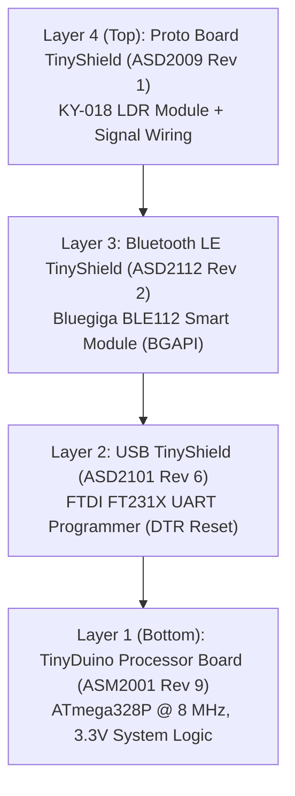

## TinyDuino Modular Hardware Architecture

The **TinyDuino LightMeter** workbench is constructed from a miniature 20mm × 20mm modular stack manufactured by TinyCircuits. Follow the official [TinyDuino Setup Tutorial](https://learn.tinycircuits.com/Processors/TinyDuino_Setup_Tutorial/) and consult the [TinyShield Compatibility Matrix](https://tinycircuits.com/pages/tinyduino-overview#tinyshield-compatibility) for bus pin assignments. Unlike monolithic development boards, TinyDuino breaks the microcontroller, USB programming bridge, wireless communications, and prototyping circuits into separable shield layers connected by a proprietary 30-pin stackable header.

---

### Component Specifications

#### 1. [TinyDuino Processor Board (`ASM2001 Rev 9`)](https://tinycircuits.com/collections/processors/products/tinyduino-processor-board?variant=14479557959)

- **Microcontroller**: Microchip ATmega328P (8-bit AVR RISC architecture)
- **Clock Speed**: 8 MHz internal calibrated / external ceramic resonator
- **Operating Voltage**: 3.3V regulated logic (3.0V – 5.5V supply tolerance)
- **Flash Memory**: 32 KB (with 2 KB used by the Optiboot bootloader)
- **SRAM**: 2 KB (2048 bytes dynamic heap and stack)
- **EEPROM**: 1 KB (1024 bytes non-volatile parameter storage)
- **Power Rail**: Low-dropout linear regulator providing clean 3.3V power to the stack bus (`VCC`).

#### 2. [Bluetooth Low Energy TinyShield (`ASD2112 Rev 2`)](https://learn.tinycircuits.com/Obsolete/BLE-bluegiga_TinyShield_Tutorial/)

- **Wireless Module**: Silicon Labs / Bluegiga BLE112 (Texas Instruments CC2540 core)
- **Bluetooth Specification**: Bluetooth Smart / Bluetooth 4.0 Single Mode Low Energy
- **Firmware**: `BGLib_U1A1P_38400_noflow` (38,400 baud UART, no hardware flow control)
- **Host Communication Pins**:
  - `Pin 3` (Arduino RX) ➔ Bluegiga TX
  - `Pin 4` (Arduino TX) ➔ Bluegiga RX
- **Radio Characteristics**: Built-in ceramic chip antenna, +3 dBm TX power, -93 dBm RX sensitivity.

#### 3. [USB & ICP TinyShield (`ASD2101 Rev 6`)](https://tinycircuits.com/products/usb-tinyshield?variant=14982646535)

- **USB Controller**: FTDI FT231X USB-to-UART serial interface
- **Auto-Reset Circuitry**: Capacitive coupling from `DTR` to the ATmega328P `RESET` pin to trigger Optiboot during firmware flashing via `arduino-cli`.
- **Serial Speed**: 115,200 baud for host diagnostics and programming.

#### 4. [Proto Board TinyShield (`ASD2009 Rev 1`)](https://tinycircuits.com/products/proto-board-tinyshield?variant=14984618887)

- **Grid Layout**: 0.1" (2.54mm) pitch through-hole prototyping matrix bringing out all 30 pins of the TinyDuino bus.
- **Circuit Population**: Host for the KY-018 photoresistor module, pull-up resistors, and optional status LEDs.

---

### 30-Pin TinyShield Bus Pinout

| Pin Range    | Function           | Notes                                                         |
| :----------- | :----------------- | :------------------------------------------------------------ |
| `Pin 0, 1`   | `RXD`, `TXD`       | Hardware Serial 0 wired to USB shield for flashing & logging  |
| `Pin 3, 4`   | `BLE_TX`, `BLE_RX` | SoftwareSerial connection to BLE112 module at 38,400 baud     |
| `Pin 7`      | `AUX_LED`          | Auxiliary LED output for nightlight & status blinking         |
| `Pin 13`     | `LED_BUILTIN`      | Onboard status indicator LED                                  |
| `Pin A0`     | `LIGHT_ANALOG`     | 10-bit analog input for KY-018 voltage divider                |
| `Pin A4, A5` | `SDA`, `SCL`       | Hardware I2C bus reserved for auxiliary environmental sensors |
| `VCC`        | `3.3V Rail`        | Regulated system logic voltage reference                      |
| `GND`        | `Ground`           | System common ground (0 V)                                    |

---

⬅️ [Back to Portal](/main/) | ➡️ [Next: Wiring & Schematic](/main/wiring-schematic/)
