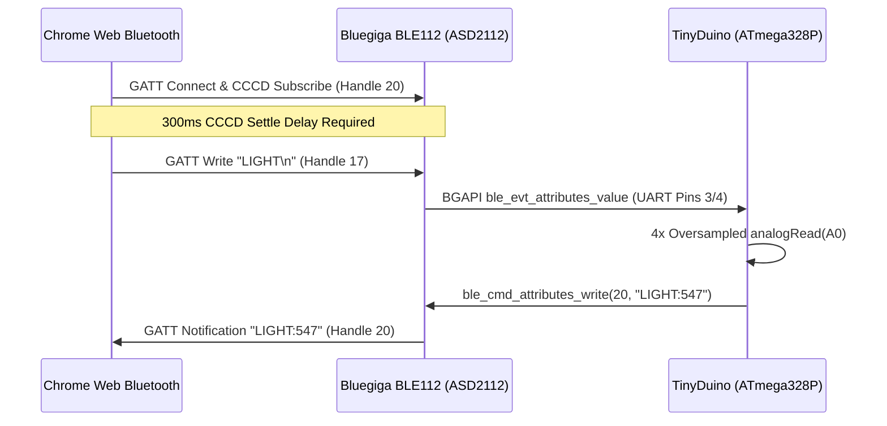

## Bluegiga BLE112 & BGAPI Protocol Specification

The **[ASD2112 TinyShield](https://learn.tinycircuits.com/Obsolete/BLE-bluegiga_TinyShield_Tutorial/)** is powered by a Silicon Labs / Bluegiga BLE112 Bluetooth Smart module. Unlike standard transparent UART bridges that forward raw serial streams, the BLE112 runs a standalone Bluetooth Low Energy stack governed by **Silicon Labs BGAPI (Bluegiga API)**. Also see Google Chrome's [Communicating with Bluetooth devices over JavaScript](https://developer.chrome.com/docs/capabilities/bluetooth).



---

### GATT Service & Characteristic UUID Profiles

The TinyShield BLE112 firmware supports two distinct profile architectures:

#### 1. Primary BGLib Data Transceiver Profile (Default)

- **Primary Service UUID**: `195ae58a-437a-489b-b0cd-b7c9c394bae4`
- **RX Write Characteristic (`c_rx_data`)**: `5fc569a0-74a9-4fa4-b8b7-8354c86e45a4` (GATT Handle `17` / `0x11`)
  - Properties: `WRITE`, `WRITE_WITHOUT_RESPONSE`
  - Max Payload: 20 bytes per write (standard BLE 4.0 ATT MTU = 23 bytes)
- **TX Notify Characteristic (`c_tx_data`)**: `21819ab0-c937-4188-b0db-b9621e1696cd` (GATT Handle `20` / `0x14`)
  - Properties: `NOTIFY`, `INDICATE`, `READ`
  - Client Characteristic Configuration Descriptor (CCCD): Handle `21` (`0x2902`)

#### 2. Cable Replacement Profile (Fallback)

- **Service UUID**: `713d0000-503e-4c75-ba94-3148f18d941e`
- **Write Characteristic**: `713d0003-503e-4c75-ba94-3148f18d941e`
- **Notify Characteristic**: `713d0002-503e-4c75-ba94-3148f18d941e`

---

### BGAPI Binary Packet Structure

Between the BLE112 module and the ATmega328P processor over `SoftwareSerial(3, 4)` at 38,400 baud, communication occurs via 4-byte framed BGAPI packets:

|  Byte Index   |        Field         | Description                                                                     |
| :-----------: | :------------------: | :------------------------------------------------------------------------------ |
|  **Byte 0**   | `Message Type & MTU` | Bit 7 = 1 for Events, 0 for Commands/Responses. Bits 6:0 = MTU size.            |
|  **Byte 1**   |   `Payload Length`   | Length of data payload following the 4-byte header.                             |
|  **Byte 2**   |      `Class ID`      | Protocol class: `0x00` System, `0x02` Attributes, `0x04` AttClient, `0x06` GAP. |
|  **Byte 3**   |     `Method ID`      | Specific command or event index within the class.                               |
| **Byte 4..N** |      `Payload`       | Parameter bytes or attribute data.                                              |

#### Boot Packet Example

When the BLE112 powers up, it emits an unprompted 16-byte boot event:

```text
80 0C 00 00 01 00 01 00 01 00 47 00 03 00 01 01
```

- `0x80`: Event packet
- `0x0C`: 12-byte payload
- `0x00 0x00`: Class 0 (System), Event 0 (`system_boot`)
- Build: `0x0047` (Build 71, Firmware Version 1.1.1)

---

### The Linux BlueZ CCCD Settling Delay

> [!WARNING]
> **BlueZ Unknown GATT Error Recovery**
> In Linux systems running the BlueZ Bluetooth daemon, calling `writeCharacteristic.writeValue()` immediately after `notifyCharacteristic.startNotifications()` causes an immediate GATT operation abort:
>
> ```text
> GATT write error (GATT operation failed for unknown reason.) — BlueZ GATT Error 133
> ```
>
> This occurs because BlueZ requires time to write the Client Characteristic Configuration Descriptor (CCCD `0x2902`) and negotiate connection parameters before accepting sequential GATT attribute writes. The workbench introduces a mandatory **300ms settling delay** following notification subscription before issuing the first `LIGHT` command.

---

⬅️ [Previous: Wiring & Schematic](/main/wiring-schematic/) | ➡️ [Next: KY-018 Calibration & Math](/main/ky018-calibration/)
