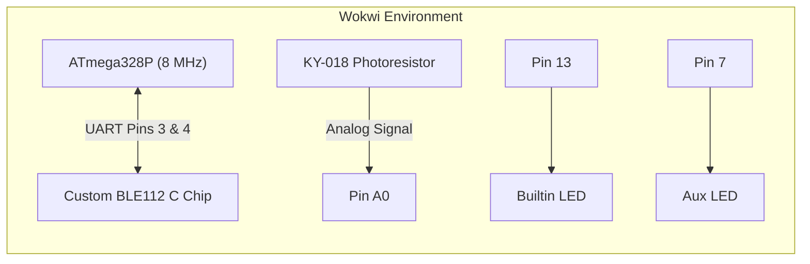

## Wokwi Hardware Simulation & Custom BLE112 C Chip

To enable offline testing and continuous integration without physical TinyDuino hardware, a full in-browser Wokwi hardware simulation environment was built.

- **Live Wokwi Simulation**: [https://wokwi.com/projects/479603659463545857](https://wokwi.com/projects/479603659463545857)
- **Local Files**: `firmware/shadow-claw-light-meter/diagram.json`, `firmware/shadow-claw-light-meter/wokwi.toml`, `firmware/shadow-claw-light-meter/ble112.chip.c`, `firmware/shadow-claw-light-meter/ble112.chip.json`.

---

### 1. Simulation Architecture



---

### 2. Configuration Files

#### `wokwi.toml`

Defines the firmware ELF artifact and compiles the custom C chip:

```toml
[wokwi]
version = 1
firmware = "build/shadow-claw-light-meter.ino.hex"
elf = "build/shadow-claw-light-meter.ino.elf"
rfc2217ServerPort = 4000

[[chip]]
name = "ble112"
sources = ["ble112.chip.c"]
```

#### `diagram.json`

Specifies the virtual breadboard components and net connections:

- `board-nano` (configured as ATmega328P @ 8 MHz)
- Custom chip `ble112` connected to Pins 3 and 4
- KY-018 photoresistor sensor module connected to Pin A0 acting as the analog light sensor divider
- Dual LEDs on Pin 13 (Built-in) and Pin 7 (Aux indicator)

---

### 3. Custom C Chip Implementation (`ble112.chip.c`)

The Bluegiga BLE112 is not a standard Wokwi catalog component. A custom C chip was created using the Wokwi Custom Chips API. The chip implements:

1. **Power-On Boot Sequence**: Upon simulation launch, transmits the exact 16-byte BGAPI boot frame (`80 0C 00 00 01 00 01 00 01 00 47 00 03 00 01 01`) over UART at 38,400 baud.
2. **BGAPI Command Parser**: Listens on RX for GATT characteristic writes.
3. **ASCII Command Handler**: When the Arduino sketch issues commands:
   - `LIGHT` ➔ Chip acknowledges and triggers notification simulation.
   - `LED_ON`, `LED_OFF`, `LED_AUTO` ➔ Updates virtual register and replies with `ACK:LED ...`.
   - `PING` ➔ Immediately responds with `PONG`.

---

### 4. Steps to Update or Deploy on Wokwi

To update the live project at [https://wokwi.com/projects/479603659463545857](https://wokwi.com/projects/479603659463545857) with the production LightMeter files:

#### Step 1: Open the Project

Navigate to [https://wokwi.com/projects/479603659463545857](https://wokwi.com/projects/479603659463545857) in Google Chrome or any modern browser.

#### Step 2: Update `sketch.ino`

1. Select the `sketch.ino` tab in the editor.
2. Replace the entire contents with [`firmware/shadow-claw-light-meter/shadow-claw-light-meter.ino`](file:///packages/xt-ml/shadow-claw-light-meter/firmware/shadow-claw-light-meter/shadow-claw-light-meter.ino).

#### Step 3: Update `diagram.json`

1. Select the `diagram.json` tab.
2. Replace the contents with [`firmware/shadow-claw-light-meter/diagram.json`](file:///packages/xt-ml/shadow-claw-light-meter/firmware/shadow-claw-light-meter/diagram.json).
3. This updates the virtual schematic to the streamlined LightMeter layout: TinyDuino ATmega328P, Bluegiga BLE112 custom chip, KY-018 photoresistor divider on Pin A0, and Aux indicator LED on Pin D7.

#### Step 4: Verify Supporting Tabs

Confirm that the following tabs remain present in the project (they are already loaded in project `479603659463545857`):

- `ble112.chip.json` (defines custom chip pinout: VCC, GND, TX, RX)
- `ble112.chip.c` (custom C chip emulation logic)
- `BGLib.h` (from `firmware/lib/bglib/Arduino/BGLib.h`)
- `BGLib.cpp` (from `firmware/lib/bglib/Arduino/BGLib.cpp`)
- `BGLibConfig.h` (from `firmware/lib/bglib/Arduino/BGLibConfig.h`)

_(Note: If creating a brand new project from scratch, add the three BGLib files and two chip files using the dropdown menu next to the file tabs)._

#### Step 5: Save & Simulate

1. Press `Ctrl+S` (or `Cmd+S` on macOS) to save the project.
2. Click the green **Play** button to start the simulation.
3. Observe the Serial Monitor: the custom BLE112 chip emits the 16-byte boot event, the firmware initializes, and the KY-018 analog telemetry streams.

---

⬅️ [Previous: Voltage Divider Derivation & Math Proof](main/divider-math/) | ➡️ [Next: Firmware Guide](main/firmware-guide/)
