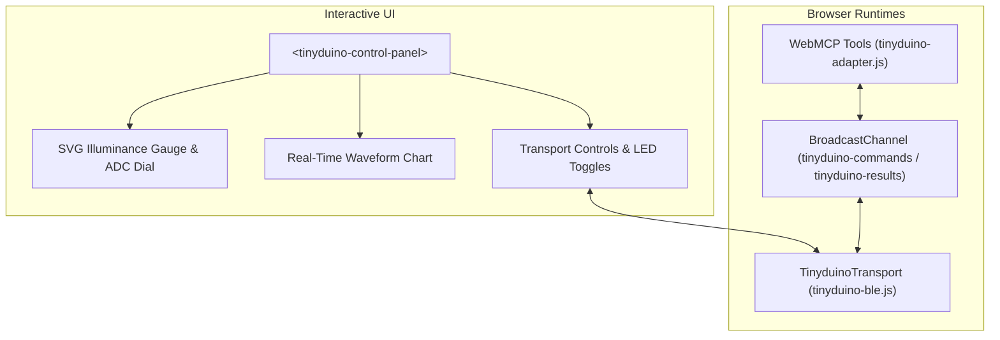

## Interactive Workbench & Custom Elements

The TinyDuino LightMeter features an interactive workbench surface rendered by custom Web Components declared in [`.agents/scripts/tinyduino-element.js`](file:///.agents/scripts/tinyduino-element.js). The workbench connects physical hardware telemetry, Web Bluetooth GATT, and AI agent sensory tools directly in the browser.

---

### 1. Component Architecture (`<tinyduino-control-panel>`)

The primary workbench element is `<tinyduino-control-panel>`, registered as a standard autonomous custom element. It operates across multiple display contexts:

1. **Dedicated Workbench Page**: Rendered directly in `pages/main/tinyduino.html` with un-sandboxed Web Bluetooth and Web Serial access (`iframe: false`).
2. **Inline Agent Card**: Dynamically injected into AI chat conversations via the `tinyduino_render_surface` WebMCP tool.

#### Key Visual Surfaces

- **Dual-Dial Metric Gauge**: Real-time SVG rendering of calibrated illuminance (0..5000+ lx) and 10-bit ADC counts (0..1023).
- **Live Waveform Visualizer**: Rolling time-series plot tracking ambient light trends and transient changes with photon cyan accent curves.
- **Lighting Scenario Tag**: Real-time classification badge (`pitch_dark`, `dark_indoor`, `indoor`, `daylight`, `direct_sun`).
- **Hardware Telemetry Inspector**: Live packet counter, raw A0 counts, computed voltage, photoresistor resistance, and Bluetooth connection status.

---

### 2. Multi-Transport Lifecycle

The workbench supports three complementary runtime modes:

| Mode                  | Transport             | Description                                                                                               |
| :-------------------- | :-------------------- | :-------------------------------------------------------------------------------------------------------- |
| **Web Bluetooth**     | GATT Handle 17 / 20   | Real-time wireless telemetry from Bluegiga BLE112 with automatic 300ms CCCD settling delay.               |
| **Web Serial**        | FTDI FT231X UART      | Direct USB cable connection at 115,200 baud with serial break recovery.                                   |
| **Offline Simulator** | Pure ESM State Engine | Simulated sensory environment for continuous integration and systems without physical Bluetooth hardware. |

---

### 3. Bidirectional WebMCP Tool Synchronization

The workbench bridge ([`.agents/scripts/tinyduino-adapter.js`](file:///.agents/scripts/tinyduino-adapter.js)) registers tools directly with the browser's Model Context:

- When an AI agent executes `tinyduino_set_led({ state: "ON" })`, the command dispatches across `tinyduino-commands`.
- The active transport writes to GATT Handle 17, and `<tinyduino-control-panel>` immediately updates its LED indicators.
- Telemetry streams emitted by `tinyduino_stream_light` publish results across `tinyduino-results` to keep the waveform and chat agent in continuous sync.

---

⬅️ [Previous: Agent Skills](main/agent-skills/) | ➡️ [Next: Namespace Isolation](main/namespace-isolation/)
